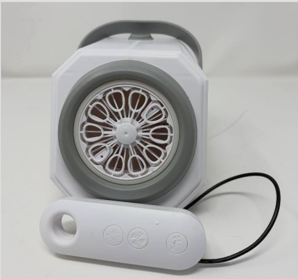
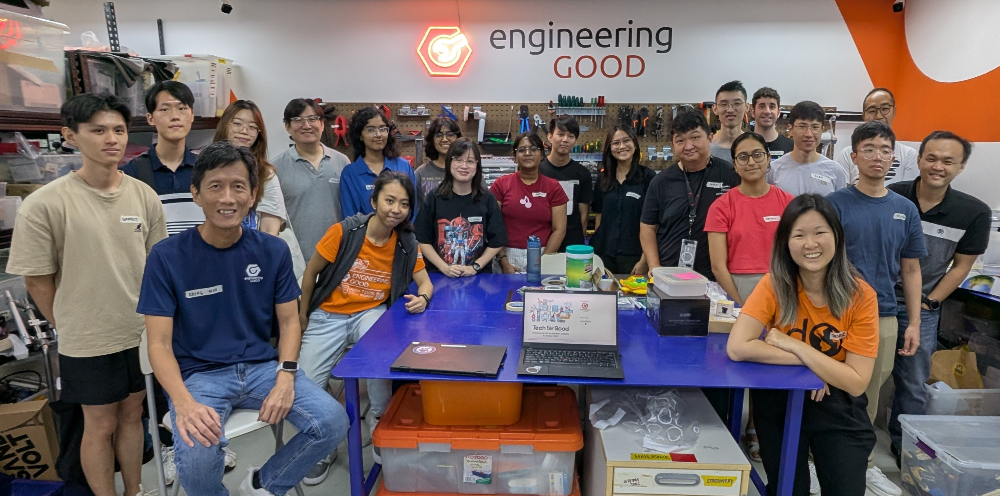

# Adapted Stage Outdoor Bubble Machine
<!--- TITLE --->
<!--- SUMMARY --->
This is a bubble machine Toy with a wireless remote controller.
We adapted the remote controller and soldered a female audio cable on it

Bubble machine is filled up with bubble solution till full, and screw back button portion to be the base
There are 3 buttons to control the overall movement of the bubble machine. When the first button is pressed, it would signal the light of the bubble machine to turn on
When the second button is pressed, it will signal the machine to blow out bubbles 
When the third (top-most) button is pressed, the machine will signal the light to turn on and it would blow out bubbles

## How to Obtain the Device

### 1. Do-it-Yourself (DIY) or Do-it-Together (DIT)

This is an open-source assistive technology, so anyone is free to build it. All of the files and instructions required to build the device are contained within this repository. Refer to the Maker Guide below.

### 2. Get Involved: Requests & Volunteering

- Need this device? If you or someone you know could benefit from the Adapted Stage Outdoor Bubble Machine, please send us an email at [contactus@engineeringgood.org](mailto:contactus@engineeringgood.org). We also invite you to share your journey with us! Tell us your stories about the device and feedback help us make our assistive tech even better!

- Want to help? We are always looking for volunteers to help build these devices for the community. If you have the skills and want to contribute, please contact us via email at [contactus@engineeringgood.org](mailto:contactus@engineeringgood.org).

## Build Instructions

### 1. Read through the Maker Guide

The [Maker Guide](/documentation/Product_Manual_Adapted_Outdoor_Bubble_Machine.pdf)  contains all the necessary information to build this device, including tool lists, assembly instructions, and testing.

### 2. Order the Off-The-Shelf Components

The [Bill of Materials](/documentation/Adapted_Outdoor_Bubble_Machine_BOM.csv) lists all of the parts and components required to build the Adapted Stage Outdoor Bubble Machine.

### 3. Assemble the Adapted Stage Outdoor Bubble Machine Device

Reference the Assembly Guide section of the [Maker Guide](/documentation/Product_Manual_Adapted_Outdoor_Bubble_Machine.pdf) for the tools and steps required to build each portion.

## How to improve this Device

As open source assistive technology, you are welcomed and encouraged to improve upon the design.

## Files

### Documentation

| Document             | Version | Link |
|----------------------|---------|------|
| Maker Guide          | 1.0     | [Adapted_Outdoor_Bubble_Machine_Maker_Guide](/documentation/Product_Manual_Adapted_Outdoor_Bubble_Machine.pdf)     |
| Bill of Materials    | 1.0     | [Adapted_Outdoor_Bubble_Machine_Bill_of_Materials](/documentation/Adapted_Outdoor_Bubble_Machine_BOM.csv)     |
| User Guide           | 1.0     | [Adapted_Outdoor_Bubble_Machine_User_Guide](/documentation/Product_Manual_Adapted_Outdoor_Bubble_Machine.pdf)    |
| Changelog            | 1.0     | [Adapted_Outdoor_Bubble_Machine_Change_Log](/documentation/CHANGES.txt)     |

## License

Copyright (c) 2024 Engineering Good.

This repository describes Open Hardware:

- Everything needed or used to design, make, test, or prepare the Adapted Stage Outdoor Bubble Machine is licensed under the [CERN 2.0 Weakly Reciprocal license (CERN-OHL-W v2) or later](https://cern.ch/cern-ohl).
- All software is under the [GNU General Public License v3.0 (GPL-3.0)](https://www.gnu.org/licenses/gpl.html).
- Accompanying material such as instruction manuals, videos, and other copyrightable works that are useful but not necessary to design, make, test, or prepare the Playback Switch are published under a [Creative Commons Attribution-ShareAlike 4.0 license (CC BY-SA 4.0)](https://creativecommons.org/licenses/by-sa/4.0/).

You may redistribute and modify this documentation and make products using it under the terms of the [CERN-OHL-W v2](https://cern.ch/cern-ohl).
This documentation is distributed WITHOUT ANY EXPRESS OR IMPLIED WARRANTY, INCLUDING OF MERCHANTABILITY, SATISFACTORY QUALITY AND FITNESS FOR A PARTICULAR PURPOSE.
Please see the CERN-OHL-W v2 for applicable conditions.

Source Location: <https://github.com/Engineering-Good/Adapted-Stage-Outdoor-Bubble-Machine>

----

<!-- ABOUT EG START -->
## About Engineering Good

- Website: [https://www.engineeringgood.org](https://www.engineeringgood.org)
- GitHub: [Engineering-Good](https://github.com/Engineering-Good)
- Instagram: [@engineeringgood](https://www.instagram.com/engineeringgood/)
- Facebook: [engineeringgood](https://www.facebook.com/engineeringgood.org/)
- LinkedIn: [engineeringgood](https://www.linkedin.com/company/engineeringgood/?originalSubdomain=sg)
- Thingiverse: [engineeringgood](https://www.thingiverse.com/engineeringgood/designs)
- Printables: [@engineeringg_4351657](https://www.printables.com/@engineeringg_4351657)

### Contact Us

For technical or non-techical questions, to get involved, or to share your experience we encourage you to 
- Visit [our website](https://www.engineeringgood.org/)
- Contact us via [contact us form](https://www.engineeringgood.org/contact-faq/)
- Email us at [contactus@engineeringgood.org](mailto:contactus@engineeringgood.org)
- Volunteering Opportunities [working in progress](https://www.notion.so/engineeringgood/Volunteering-Opportunities-2025-ffa3d3ec8bb34ac7a672f5c10ee8177b)
<!-- ABOUT EG END -->
